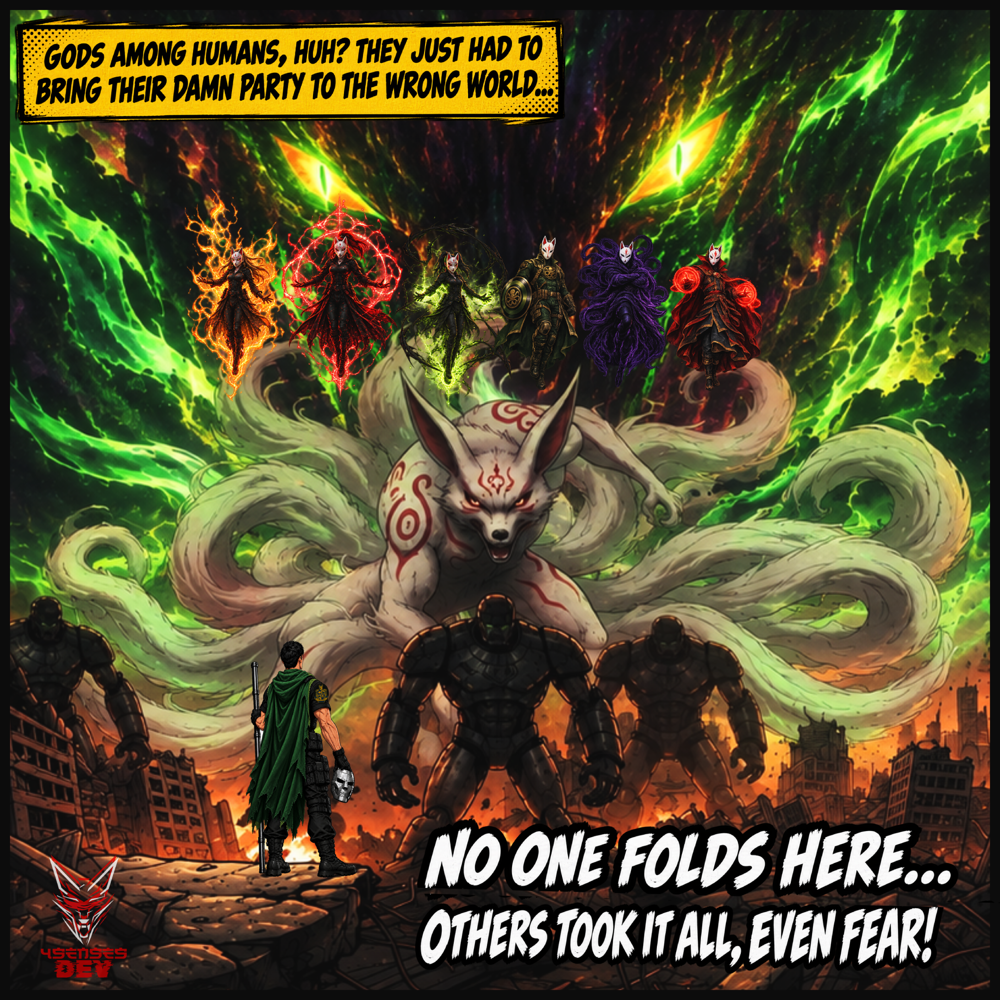

#

<p align="right">
  
</p>

***


# **DOOMSDAY IS COMING...<br><br>Will you run, or will you stay?<br><br>I'm in charge of the OST this time, whether you like it or not!**

<br>

### **_Hope you're ready for what's coming..._**

<br>

<p align="center">
  
</p>

<br>

<details>
  <summary><strong>How it all started (Context & Motivation)</strong> — <em>Click or tap to view</em></summary>

<br>
<br>

<div align="justify">

### *The Damn Day YouTube Autoplay Threw a Remix at Me...*

**April 2026**. One of the bands I respect the most decided to release a remix one of the most popular tracks from their last album, teaming up with another group of artists who are also well known for the quality of their work. The result “fell short of expectations”, just saying. But this is more than just the usual internet criticism. It's a personal opinion based on the high quality of everyone involved.

Come on, if you follow team sports, I'm willing to bet you have a favorite team. And I'm sure you've seen this happen: your team can be really good, full of top-level athletes, and then, out of nowhere, they lose. You're left wondering, What the hell happened? They're all so good!

There could be all sorts of reasons for this in sports. But since we're talking about music, my theory is that the artists decided to explore new territory and try something different. I'm all for that, because I spend a lot of my own time doing exactly the same thing: trying new things and experimenting.

On the other hand, I don't know whether YouTube shows different comments depending on the region or whether everyone sees the same comments when they open the video. Either way, many of the most visible comments suggest that releasing this remix was a bad idea, to put it mildly. Some of them are so cruel. But we're not here to sit back and passively judge a band's creative decisions or the comments it gets for daring to play around with its own “modeling clay”.

After seeing so many comments, I said to myself: imagine waking up one day feeling like doing something different. You put your work out there for your followers to see, and suddenly you're flooded with unpleasant comments.

But I come from the world of science, where my opinions and thoughts don't matter in the slightest. They never have. The only thing that matters is evidence that can be tested and backed up by data. So I asked myself: with so many negative comments, surely everyone saying these things must be an expert in making music, right?

I'm just a simple mortal, so I decided to find out how difficult it really is to learn music and “build” a song. After a lifetime of academic training and respect for my teachers, I simply can't give an opinion on anything without taking at least a little time to learn about the subject first. I need enough information to form my own judgement before going around repeating other people's opinions like a parrot and throwing hate at people. I already live in a hostile enough hell without adding to it by doing the same thing as those people who keep it that way.

Besides, if you've seen my other repos, you already know that I tend to do things in unconventional ways. I have my reasons.

  </div>
</details>

<br>

<details>
  <summary><strong>Into the Multiverse (The Storyline)</strong> — <em>Click or tap to view</em></summary>

<br>
<br>

<div align="justify">

### *A Journey Between Universes*

From this point on, I'll leave the usual explanatory style behind for a while and switch to storytelling to explain the methodology behind this project.

So, if you're not familiar with dimension-hopping and the consequences of messing with the timeline, you can head over to Disney+ and watch both seasons of **_Loki_** or **_Doctor Strange in the Multiverse of Madness_**. Once you're done, come back and keep reading. I take no responsibility if you end up even more confused than usual.

In one of my previous repositories, we were on Earth-888. This time, though, I'm starting from Earth-616, our own Earth, home to 4SensesDev.

Here, I decided to ask a few people I know who have some knowledge of music. The question sounded simple enough, but it turned out to be more complicated than it seemed:

**_What is the most important thing about a song?_**

Some people answered, although they seemed a little hesitant. I didn't even ask a few others. I simply forgot, I'll admit it. And with the deadline practically breathing down my neck, I decided to turn to social media and ask some artists whose talent I respect directly.

The result? Not a single reply. And I can't really blame them. After all, why would an artist whose work I respect take the time to answer an ordinary mortal who shows up out of nowhere with questions about music composition? **The universe is indifferent by nature. The stars are part of it, too.**

With time running out and not enough answers to put something decent together, I had no choice but to try something far more drastic: visit another Earth in the multiverse.

That's how I ended up back on Earth-888. There, I came across a rather emotional little devil named Akuma-san, who would end up playing an important role in this story.

The more I got to know him, the more I realised that this little demon was an alternate version of me, a version of 4SensesDev. He told me that, in his world, his role was to gather information and use it to prove that little demons like him could live like everyone else, lead dignified lives, and contribute their knowledge to the world without constantly feeling they had to perform at their absolute best just to deserve a chance. The same chance every other mortal gets simply for existing.

He told me that the humanities were his area of expertise and that he loved exploring human emotions. After all, he was a little demon, and he wasn't allowed to be like everyone else. In that world, beings like him were nothing but a burden and shouldn't even exist. Even so, he still believed that one day he might be able to experience those emotions naturally.

At that point, I had no idea how to react. In my world, he would have been exterminated by now. Where I come from, emotions are a weakness you have to stamp out if you don't want to get yourself killed or fall into disgrace. The motto most people live by is to trample everything and everyone in their way, and the more ruthlessly you climb over others to get ahead, the better. The lesson they try to beat into you is that it's not about being perfect, but about making everyone think you are.
I wonder how long this little demon would last in a hell like the one I come from.

But anyway, let's not lose sight of the goal. I told Akuma-san I was in that world to find out what mattered most in a song. He admitted he didn't know, but agreed to help me.

We came across ruins left by that world's ancestors and discovered symbols carved into stone that spoke of conveying messages, expressing opinions and feelings, or simply having fun. We found that some people sang against the system, others sang in favor of unity, and others were known for spreading joy. All of this showed that music had been part of human life for a very long time.
These discoveries helped me understand why I'd never tried to learn to play an instrument in my own world. To me, music is like magic. The kind of magic that can stir emotions, transform people, or make the suffocating atmosphere of that hell we live in a little easier to bear.

To me, playing an instrument without being able to feel anything or having any intention behind it was disrespectful to real artists.

I told the little demon how music was viewed in my world these days, but he wasn't impressed. He told me things were pretty much the same in his world: all that mattered was marketing, views on streaming platforms, and sudden spikes in popularity. Relics like the ones we'd found were buried all over the place because nobody gave a damn about that stuff.

In fact, most of the music in his world was now AI-generated, and it was so empty and repetitive that anyone who dared to experiment was condemned even more.

**_Buuut_**, you know me, so I said, “Well, looks like we're back among the condemned. What a shocker! Let's experiment. We've found enough to make something decent”.

That's when Akuma-san pointed out that, since neither of us knew a damn thing about emotions, why not make a remix? One where we could put everything we'd learned in that place to use.

So, _**today's goal is to create a song using music theory and other relevant concepts. The idea is to gain enough practical experience and evidence to build a solid argument and form an opinion about music creation based on actual data.**_

### Secondary Objectives

- Identify basic methods for learning music.
- Evaluate alternative tools for making music.
- Create a tangible piece of music.
- Identify the risks and limitations involved in creating the piece.

**_Note_**: Since this whole exercise was inspired by a remix, I'll try to create one myself to keep things consistent.

  </div>
</details>

<br>

<details>
  <summary><strong>Building a Song (The Experimental Approach)</strong> — <em>Click or tap to view</em></summary>

<br>
<br>

<div align="justify">

### *Metodology*

After discussing the goals with Akuma-san, he told me that, in his world, DAWs are the least artificial things around, since musical instruments don't exist there. He explained that DAWs (Digital Audio Workstations) allow people to make music, but they're outdated and overly complicated. These days, everyone just asks AI to generate sounds or, better yet, produce entire songs for them.

With a DAW, on the other hand, you have to add sounds you've created yourself or resort to demonic methods like MIDI, where you have to place notes one by one on a sort of grid. That's why almost nobody uses DAWs in his world: they're simply too complicated for people to deal with.

After hearing about DAWs, I decided to try one out using MIDI. Sure enough, you can place notes that sound good if you know something about music. But since neither of us knew a damn thing about it, I came up with the following plan:

1.	Define the song's sections, tempo, and overall length.
2.	Ask Akuma-san to choose several songs he's interested in that share a common message, some others he simply likes, and a few more he wants to use to put the DAW to the test.
3.	Choose four instruments: electric guitar, acoustic guitar, bass, and drums. The little demon will take care of the ambient sounds.
4.	Once the songs have been selected, search online for resources that can help us figure out what each instrument sounds like in each song, or find the sheet music, if anyone still has it posted somewhere.
5.	Instead of building each song section the usual way, which neither of us has a clue how to do, we'll add elements inspired by each selected song that fit the section we're working on. However, rather than building each section with all the instruments at once, we'll work on the melodic arrangements one instrument at a time.
6.	Once we've created the melodies for each instrument in every section, we'll put them together to build a complete song featuring all the instruments.
7.	Finally, we'll listen to the finished result and document what it was like to build a song note by note using MIDI, with each of the selected instruments.

  </div>
</details>

<br>

<div align="center">
  <div style="display: block; overflow-x: auto; width: 100%;">

**Frankenstein's Monster Is Alive...**

<a href="https://www.youtube.com/watch?v=hy0ug1G7t-Q" target="_blank"><br></a><br><em>Click the image to unleash the monster on YouTube.</em>

  </div>
</div>

<br>


<details>
  <summary><strong>From Theory to Musical Mayhem (The Experiment's Outcome)</strong> — <em>Click or tap to view</em></summary>

<br>
<br>

<div align="justify">

### *The Making of the Monster*

This magic nearly killed us from the start. We had a DAW, our chosen tracks, and all the sections planned out for the Frankenstein’s Monster we were going to build piece by piece. Even so, increasingly complicated forms of witchcraft kept cropping up.

First, the grid demanded a BPM setting. Since we'd already planned the song's sections to make it about 3 minutes and 33 seconds long, we had to set the tempo to 144 BPM. That meant taking on a pretty fast song for two ordinary mortals like us.

The next problem came when we listened to the tracks we'd picked and tried to decide which parts to include in our abomination. We ran into things that were completely new to us, like 2/4, 3/4, 4/4, and 6/8. These numbers appeared at the beginning of the sheet music, and we had no idea what they meant. Eventually, we learned that they were time signatures, showing how the beats are grouped within each measure.

Yes, we had to learn about note values: half notes, quarter notes, eighth notes, and so on, along with their corresponding rests.

But then we realized that still wasn't enough. All we could see were little dots and lines on a musical staff made up of five lines and four spaces. So we had to learn what those dots and lines meant, which led us to study the musical notes from A to G.

But we didn't stop there. Next came chords, followed by the major and minor scales for each note, as shown in the example below.

```text
==================================================
                  MUSICAL NOTES
==================================================

         A    B    C    D    E    F    G

==================================================
             G MAJOR SCALE (EXAMPLE)
==================================================

   Notes:    G    A    B    C    D    E    F
  Chords:    G    Am   Bm   C    D    Em   F#

==================================================
             SCALE DEGREES AND CHORDS
==================================================

  Degrees:   I    ii   iii  IV   V    vi   vii°
   Chords:   G    Am   Bm   C    D    Em   F#°
==================================================
```
<br>

Now that we knew how to build pretty much any scale mortals use, so to speak, we had the tools we needed to tackle sheet music and put each song fragment exactly where we wanted it.

The whole process took us three months. Three months spent learning not only how to enter notes using MIDI, but also which notes to expect from each instrument in my world, so I could play something decent if I ever made any progress with this whole emotions business.

After wrestling with each of our chosen songs to extract a fragment and recreate it in MIDI, even knowing it wouldn't sound the same, we did our best to stay true to the original compositions out of respect for their creators.

But then another problem came up. When we stuck to the original note durations, some sections just didn't sound the way the original songs were supposed to. So we had to turn eighth notes into quarter notes and make other adjustments to get something that sounded halfway decent.

Eventually, each instrument had its own song fragments arranged across the sections we'd defined at the start. It was time to put everything together into one complete song and see how it sounded as a whole. And we pulled it off, although I'll admit some parts didn't turn out the way I'd hoped. But hey, rookie mistakes. We can't do in three months what takes a real artist a decade to master.

Honestly, I have no idea whether the artists or their fans will like what we've done, but Frankenstein's Monster has come to life this October, and it's ready to terrorise YouTube.

The idea came from listening to bands like **_Paledusk_**, who are incredibly good at packing what feels like an entire album into a single song. It's a shame we couldn't include any of their tracks in our creation, but we simply ran out of room. The same goes for other groups making brilliant music. That's why we're mentioning them here: they were part of our inspiration this time around. The goal was to create something that I would, at the very least, call a **remix<sup>remix</sup>** haha, rather than just random noise.

In a future update, Akuma-san will write a story that could serve as the basis for lyrics for the “song”, since neither of us knows how to sing.

  </div>
</details>

<br>

<details>
  <summary><strong>Conclusions (More Than Notes and Algorithms)</strong> — <em>Click or tap to view</em></summary>

<br>
<br>

<div align="justify">

### *Beyond the Noise*

- We learned some basic music theory, enough at least to read sheet music and identify notes and chords in a progression.

- We managed to use a DAW to create a song while also testing its ability to combine multiple songs with different styles and rhythms into a single piece.

- We managed to create a “piece of music”, although whether it deserves that name is up to the experts. For now, I'll call it what I mentioned earlier: a remix^remix, haha.

- We ran into several problems that led us to try different approaches, such as doubling or shortening note lengths to stay as close as possible to the original tracks while working with that demonic technique known as MIDI.

- We decided not to go beyond scales in our music theory studies. Until we understand emotions a little better, that’s as far as we’re willing to go. For 4SensesDev, music is magic, and they would hate to find out how that magic actually works. Akuma-san, on the other hand, wants to keep investigating, so he’ll head to Earth-616 to see what he can discover about good music.

Now for the most important part. 

_After spending three months learning enough to form an informed opinion about a remix, here's my answer: I don't want to give my opinion after all._

Now that I've had a chance to get a rough idea of how a song is made, I understand what goes into building each section, making the instruments fit together, getting everything to make sense, and, on top of that, conveying a message, an emotion, or simply having fun. There's a lot of work behind all of this, and I have even more respect now for those who make a living from music.

I also find it amusing to see people showing up out of nowhere in the comments just to throw hate around for free. But I guess everyone behind a screen is an expert at everything.

That said, the artists I respect shouldn't get too comfortable either. Akuma-san can now have a laugh if they dare release songs even worse than the remix we made here. With this monster finally unleashed, if there's a remix capable of causing terror on YouTube, it has to be this one. As artists, they can't possibly release anything worse than this, haha.

Anyway, yes, I did all of this without being able to see the way most people do. One point for me. I won't be able to see the negative comments about the music made by the artists I follow, and now that I have some idea of the work that goes into creating this kind of thing, all that's left is to wait and see what the next generation brings.

I hope they bring us something fun and authentic. I'd hate to see music fall to AI as well, leaving us all trapped in a world like Akuma-san's.

For now, all I can do is thank all the bands and artists whose music I managed to include in that Frankenstein's monster, created especially for Halloween. 

I also owe an apology to those I couldn't include because we simply ran out of room. They haven't been forgotten, though. Their music has been part of this journey, even if I couldn't fit it all into one track.

I've never had the chance to attend a concert, but I'm working on changing that. For now, this project has been another way to get closer to the music and the artists whose work I admire

If I could go from climate forecasting to building musical monsters, I'm sure I'll find a way to make that happen, too.

In other hand, this may sound a little silly, but working with what I'd learned about music theory and MIDI reminded me of a sequence I learned a while ago. It goes like this:

**DNA → RNA → AA → Protein → Enzyme**

Yes, if there's anyone here who knows molecular biology, now's your chance to be offended, haha. How dare a mere mortal (who can't even see) compare these two worlds so freely? But that's the point: it's just a silly idea that caught my attention.

Now I wonder if creating things like this is what all those people meant when, for decades, they've told me _"I should do something else"_ simply because I don't fit the mold they have in mind.

Are they happy now? Or is this just another thing they won't be able to replicate, only to come back and tell me the same old thing again? Hahaha.

  </div>
</details>

<br>

<details>
  <summary><strong>Behind the Mix (Every Instrument Tells a Story)</strong> — <em>Click or tap to view</em></summary>

<br>
<br>

<div align="justify">

### *APPENDICES*

Yes, we have appendices.

The idea behind this remix was to cram as many songs as possible into a single piece without having the whole thing self-destruct in the process. So, to make things a little more interesting, can you identify every song featured in this remix^remix?

To make the challenge a little easier, I decided to include a separate video for each instrument. But let me make one thing clear from the start: some parts are entirely my own invention. In fact, I made up most of the drum parts myself, and there are invented sections in the other instruments too. So identifying every song won't be that easy, haha. Or at least, that's what I hope, even though most of the artists are pretty famous.

You know what? I'll just leave the links to the videos for each instrument and call it a day.

#### **Multimedia Material**


<div align="center">
  <div style="display: block; overflow-x: auto; width: 100%;">

|  |  |
| :---: | :---: |
| **Peach Words (Remix^Remix) [Official Audio]**<br><a href="https://youtu.be/hy0ug1G7t-Q" target="_blank"><br></a> | **Peach Words (Remix^Remix) [Ambient sound]**<br><a href="https://www.youtube.com/watch?v=pPJtbaMX-uY" target="_blank"><br></a> |
| **Peach Words (Remix^Remix) [Electric Guitar]**<br><a href="https://www.youtube.com/watch?v=jKX1S7EiKFc" target="_blank"><br></a> | **Peach Words (Remix^Remix) [Acoustic Guitar]**<br><a href="https://www.youtube.com/watch?v=imGIc170bF4" target="_blank"><br></a> |
| **Peach Words (Remix^Remix) [Bass]**<br><a href="https://www.youtube.com/watch?v=7aZSUSc__S8" target="_blank"><br></a> | **Peach Words (Remix^Remix) [Drums]**<br><a href="https://www.youtube.com/watch?v=_yYUkYBnFBc" target="_blank"><br></a> |

  </div>
</div>

#### **(Audio Issues) YouTube's Volume Police Strike Again**

The audio sounds just fine in my DAW and when played locally on my PC. I'm not trying to deafen anyone; I'd quite like to keep my own hearing, too. But upload the videos to YouTube and suddenly the audio sounds noticeably quieter. Apparently, this monster has YouTube sweating, so the platform just couldn't keep its grubby little hands off my mix.

I'll address this in a future update. I may have to go back to the original DAW projects, rebuild the videos, adjust the audio levels there, and upload everything again, just to get YouTube to stop messing with the experiment on a diva's whim.

Three months spent learning music, hours spent putting everything together, and now I'm negotiating with a platform that apparently thinks it's the star of the show. **I made a musical monster, not a request for unsolicited audio "supervision".**

Now, someone is bound to complain that this platform (GITHUB) is only for code because it's a platform for developers, blah, blah, blah.

So I've got something for you, too. What do you think I used to make the videos I uploaded to YouTube? That's right: code, specifically Python, because I felt like it.

Here's the relevant part of the code, so you can feed it to your AI of choice...

```python
image_clip = ImageClip(temp_image_path).set_duration(duration).resize((WIDTH, HEIGHT))
video_clip = image_clip.set_audio(audio_clip)  # Combine image and audio
print("Rendering high resolution video...")  # Export to MP4 with maximum audio quality protection
video_clip.write_videofile(output_video_path, fps=30, codec="libx264", audio_codec="aac",  # MP4 container requires AAC audio
    audio_bitrate="320k", bitrate="12M", preset="fast",  # Maximum standard audio bitrate to prevent quality loss
    ffmpeg_params=["-pix_fmt", "yuv420p"])  # Ensure broad playback compatibility
```
<br>

By the way, if anyone is wondering how I made the images for the videos, here's what I did: I asked AI to generate the characters I had in mind, since, because of my condition, I couldn't draw them myself to a decent standard in such a short time.

After that, though, I put everything together myself using an editing program. Feel free to use whichever program you like if you want to recreate the process. That's also where I added the comic-book effects and the other details.

And finally, in a little nod to Tom Holland, I'll let you in on this much: the image is based on a particular story arc from a world-famous Japanese animated series I watched as a kid. The part of the arc that inspired the image began airing in October, so what a coincidence that we're doing this in October too, haha.

I challenge you to figure out which series it is and which story arc I'm referring to. It's not all science and work, so have a little fun, haha.

  </div>
</details>

<br>

*** 

<div align="justify">

You know what? Akuma-san will be dropping by whenever he wants to learn more about music and emotions. I guess I shouldn't fall behind, so I'm going to get myself a guitar. Yes, one of the cheapest ones I can find, haha. Then I'll teach myself how to play. I bet it'll be easier than entering every single note by hand in a DAW using MIDI. I'm not about to lose to an emotional little devil, haha!

But now I'm curious about something that's always there in the background, yet we hardly ever pay attention to it: the crews and staff behind bands and artists. Now that I've had a glimpse of what goes into creating music, I'd love to learn more about the people who make everything happen behind the scenes. What do they actually do, and could someone like me become part of a band's crew or staff, with room to learn, grow, and take on more responsibilities over time?

As you've probably figured out by now, whenever I take on something, I try to do it as well as I possibly can. That's simply how I like to work. So, if you know of any band or artist out there that might be interested in bringing a blind mortal like me onto their crew or staff, even in a small way, please let me know. My priority would be to contribute as much as I can while learning everything possible along the way. Remote opportunities would be welcome, too. You can find my social media links in the section dedicated to them.

Along the way, I'd also love to use what I learn to help improve accessibility for other visually impaired people. It would be a meaningful bonus to be able to make something “interesting” for others like me.

And if this little adventure has inspired anyone to learn more about music, I'm also happy to share what I've learned through the same channels.

Until next time, keep practicing, get stronger, and I'll see you in another repository with some other crazy project. Although, knowing me, the next one will probably have more to do with code. I'm in the mood to get back to that for a while, haha.

</div>

<div align="justify">

***

### Software used:

<br>

* **Digital Audio Workstation (DAW):** _Any DAW of your choice._
* **Image Editing Software:** _Any image editor of your choice._

* **Python**
  _(it is recommended to use the latest versions)_

</div>

<br>

***

### "Contact" section!

<div align="justify">
If you have questions, feel free to ask. If you’d like to share an idea or simply have someone listen, this space is open to you. We may come from different paths, but every step matters here. Let’s build together!
</div>
<br>

[](https://instagram.com/4sensesdev)
[](https://x.com/4sensesdev)
[](https://youtube.com/@4sensesvideo)

<br>
<br>

***

<div align="justify">

### License

This work is licensed under a
Creative Commons Attribution-NonCommercial-ShareAlike 4.0 International License.

See the LICENSE file for details.

</div>

<br>
<br>

<div align="center">

© 2026 4sensesdev  
Licensed under CC BY-NC-SA 4.0

</div>

<br>
<br>
